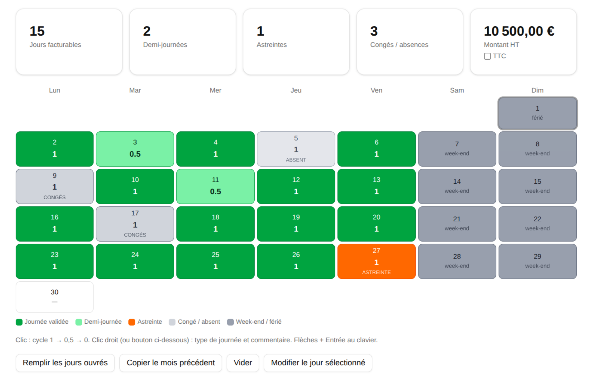

# dtfcra

Application web **auto-hébergée** de **CRA (compte rendu d'activité) / timesheets** pour
freelances IT en régie. Multi-utilisateurs, isolation stricte des données par compte.



- Saisie mensuelle par mission sur un calendrier (clic 1 → 0,5 → 0, types, commentaires),
  sauvegarde automatique, jours fériés calculés localement (13 territoires français).
- Plusieurs missions en parallèle (plafond de 1 jour par date), unité jour ou heure.
- Tableau de bord : jours, chiffre d'affaires, taux d'occupation, graphique 12 mois.
- Exports : **PDF** à votre image (logo, couleur, SIRET/TVA), **Excel**, **Excel au gabarit du
  client** (upload `.xlsx` + mapping de cellules), **CSV**.
- Sécurité : mot de passe + 2FA TOTP + passkeys, CSP à nonce, journal d'audit.
- Aucun email, aucun service externe : tout reste chez vous.

Stack : Next.js 16 · React 19 · TypeScript · PostgreSQL 18 · Drizzle · Better Auth ·
Tailwind v4 · shadcn/ui. Voir [`docs/architecture.md`](docs/architecture.md).

## Utilisation

1. **Créer le compte** : le premier compte s'inscrit librement sur `/register`. Les suivants
   exigent `ALLOW_SIGNUP=true` (ou la commande hébergeur `auth:create-user`, ci-dessous).
2. **Profil** (`/settings/profile`) : raison sociale, SIRET, TVA, logo, couleur de marque.
3. **Client puis mission** (`/clients`, `/missions`) : TJM en euros, unité jour/heure,
   territoire des jours fériés.
4. **Saisir le CRA** (`/cra`) : « Créer le CRA du mois », cliquez les jours (1 → 0,5 → 0),
   clic droit pour le type et le commentaire. Raccourcis : jours ouvrés, copie du mois
   précédent, vider.
5. **Exporter** : boutons PDF / Excel / CSV / gabarit client ; tous les CRA sont dans `/archive`.
6. **Sécurité et données** : 2FA et passkeys dans `/settings/security`, export JSON RGPD et
   suppression du compte dans `/settings/data`.

Mot de passe oublié (pas d'email) : l'hébergeur lance
`pnpm auth:reset-password <email> <nouveau-mot-de-passe>`.

## Installation (développement)

Prérequis : **Podman** (rootless) ou Docker. Rien d'autre n'est installé sur la machine :
dev, build et tests tournent en conteneur.

```bash
git clone https://github.com/lazysysadm/dtfcra.git && cd dtfcra
cp .env.example .env           # renseigner les CHANGE_ME (aide dans le fichier)
./scripts/dev-env.sh up        # réseau + PostgreSQL 18 + image de dev
./scripts/dev-run.sh pnpm install
./scripts/dev-run.sh pnpm db:migrate
./scripts/dev-server.sh        # http://localhost:3000  (passkeys : utiliser localhost)
```

Données locales dans `./.data` et sauvegardes dans `./backups` (modifiables avec
`DTFCRA_DATA_DIR` et `DTFCRA_BACKUP_DIR` dans `.env`). Arrêt : `./scripts/dev-env.sh down`.

Qualité : `./scripts/dev-run.sh pnpm lint && ./scripts/dev-run.sh pnpm typecheck &&
./scripts/dev-run.sh pnpm test && ./scripts/dev-run.sh pnpm build`
(`pnpm test:e2e` : voir `Containerfile.e2e` et `e2e/`).

## Déploiement (production)

```bash
cp .env.example .env     # POSTGRES_PASSWORD, BETTER_AUTH_SECRET (>= 32 car.), APP_URL en https://,
                         # TRUSTED_PROXY (IP/CIDR du reverse proxy)
podman build --format docker -f Containerfile -t local/dtfcra:latest .
podman-compose up -d     # ou : docker compose up -d
```

`compose.yaml` lance `db` (PostgreSQL 18, volume persistant), `migrate` (one-shot) puis `app`
(image standalone non-root, système de fichiers en lecture seule, healthcheck,
`127.0.0.1:3000`).

- **TLS** : placez un reverse proxy (Caddy, Traefik, Nginx) devant l'app. En production,
  `APP_URL` doit être en `https://` et `TRUSTED_PROXY` renseigné, sinon l'app refuse de
  démarrer (échappatoires : `ALLOW_INSECURE_APP_URL`, `ALLOW_NO_TRUSTED_PROXY`).
- **Santé** : `GET /api/health` → `{"status":"ok"}`.
- **Comptes** : le premier compte se crée sur `/register`. Pour en ajouter, mettez
  `ALLOW_SIGNUP=true` le temps de l'inscription, puis remettez `false`.
- **Sauvegarde** : `podman-compose exec db pg_dump -U dtfcra -d dtfcra --format=custom
--compress=6 > dtfcra.dump`, plus le volume `dtfcra_uploads`. Restauration :
  `pg_restore -U dtfcra -d dtfcra --clean --if-exists < dtfcra.dump`.
  (`scripts/backup.sh` / `restore.sh` font la même chose pour le poste de dev.)

## Variables d'environnement

| Variable                            | Rôle                                                                            |
| ----------------------------------- | ------------------------------------------------------------------------------- |
| `DATABASE_URL`, `POSTGRES_PASSWORD` | Connexion / mot de passe PostgreSQL                                             |
| `BETTER_AUTH_SECRET`                | Secret de session (>= 32 caractères)                                            |
| `APP_URL`                           | URL publique (https en prod)                                                    |
| `ALLOW_SIGNUP`                      | `true` pour autoriser les inscriptions après le premier compte (défaut `false`) |
| `TRUSTED_PROXY`                     | IP/CIDR du reverse proxy (obligatoire en prod)                                  |
| `UPLOAD_DIR`                        | Logos et gabarits (volume en prod)                                              |
| `LOG_LEVEL`                         | `fatal` … `trace` (défaut `info`)                                               |

## Documentation

[`SECURITY.md`](SECURITY.md) · [`docs/architecture.md`](docs/architecture.md) ·
[`docs/licenses.md`](docs/licenses.md).

## Licence

[MIT](LICENSE). Audit des licences des dépendances : [`docs/licenses.md`](docs/licenses.md).
